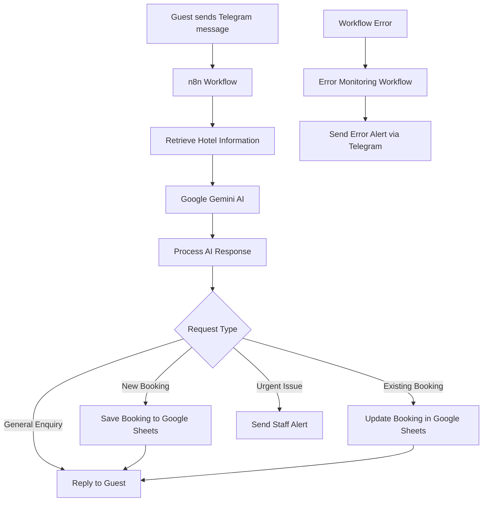

Cedar Haven Hotel & Suites – AI Hotel Reception Assistant

Project Overview

The Cedar Haven Hotel Reception Assistant is an AI-powered automation prototype designed to improve hotel guest communication and simplify reception operations.

Built with n8n and Google Gemini 2.5 Flash, the system can respond to guest enquiries, collect booking details, generate booking references, update booking records, and alert hotel staff about urgent guest issues.

Key Features

* Automated Guest Enquiries: Answers questions about hotel services and room prices.
* Booking Enquiries: Collects guest information and generates unique booking references.
* Booking Record Management: Stores and updates guest booking enquiries in Google Sheets.
* Urgent Issue Escalation: Sends Telegram alerts to staff when urgent issues are reported.
* Emergency Handling: Provides appropriate emergency guidance and alerts staff.
* Error Monitoring: Detects workflow failures and sends Telegram error notifications.
* Reliability Improvements: Includes retry settings for important Telegram notifications.

Technologies Used

* n8n – Workflow automation
* Google Gemini 2.5 Flash – AI-powered guest communication
* Telegram – Guest interaction and staff notifications
* Google Sheets – Booking enquiry records
* JavaScript – Data processing and workflow logic

Workflow Overview

1. A guest sends a message through Telegram.
2. The workflow retrieves relevant hotel information.
3. Gemini processes the guest’s message and generates a response.
4. Booking enquiries are collected and saved in Google Sheets.
5. Existing booking enquiries can be updated using their booking reference.
6. Urgent issues trigger staff notifications through Telegram.
7. Workflow errors are monitored and reported through a separate error-monitoring workflow.

Reliability and Testing

The prototype has been tested with:

* General room enquiries.
* New booking enquiries.
* Existing booking updates.
* Invalid booking references.
* Urgent maintenance reports.
* Emergency reports.
* Workflow error notifications.

Important Project Limitations

This is a working prototype developed for learning and demonstration purposes.

* It is not a live production deployment.
* It is not officially endorsed by Cedar Haven Hotel & Suites.
* Room availability is not connected to a live hotel inventory system.
* Booking enquiries remain pending until confirmed by hotel staff.
* Production deployment would require additional security, concurrency controls, and operational testing.

Future Improvements

* WhatsApp Business integration.
* Website live chat integration.
* Live room availability checking.
* Improved booking management and confirmation.
* Advanced reporting and analytics.

Project Purpose

This project demonstrates how AI and workflow automation can help hospitality businesses improve guest communication, reduce repetitive administrative work, and respond more quickly to important guest issues.

Built as part of my journey into AI automation and workflow development.

## System Architecture

The diagram below illustrates how the hotel reception assistant processes guest messages and handles booking enquiries, urgent issues, and workflow errors.

